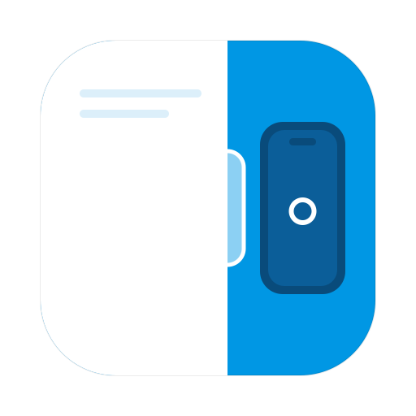
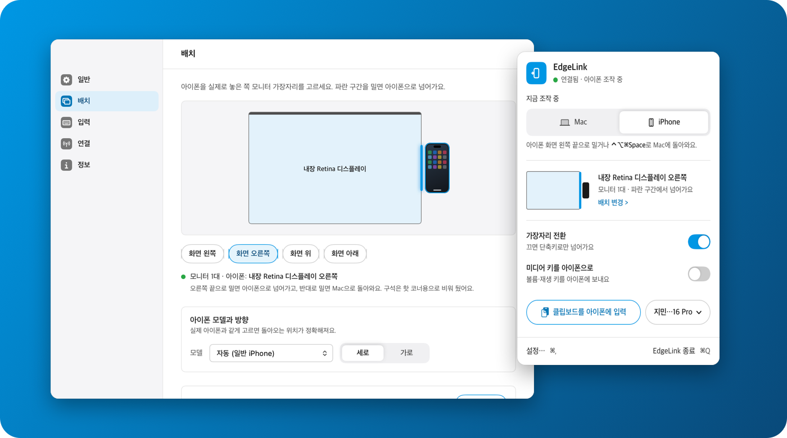
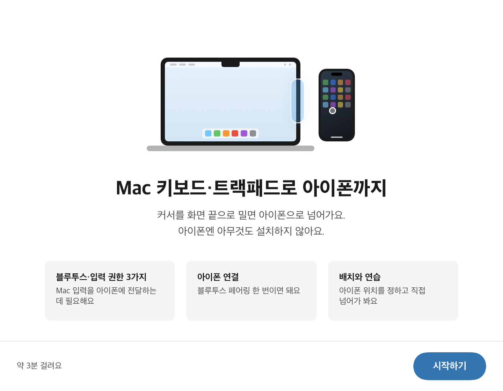
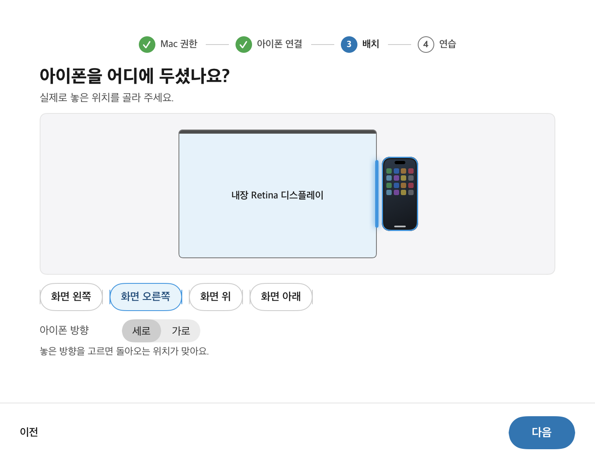
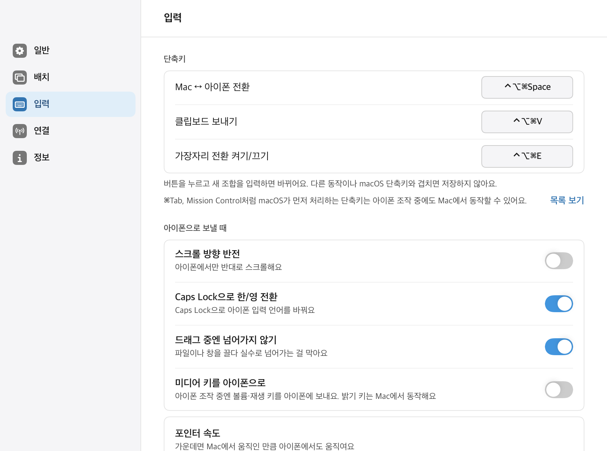
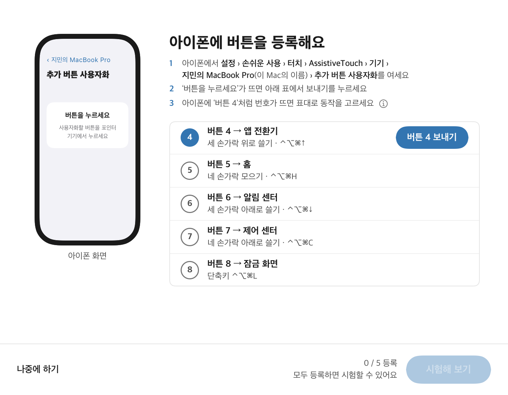

<p align="center">
  
</p>

<h1 align="center">EdgeLink</h1>

<p align="center">
  <b>Mac 키보드·트랙패드 그대로, 아이폰까지.</b><br>
  커서를 화면 끝으로 밀면 아이폰으로 넘어가요. 아이폰엔 아무것도 설치하지 않아요.
</p>

<p align="center">
  <a href="https://github.com/JUNG-WOOSEUNG/EdgeLink/releases/latest"></a>
  
  
  
  
</p>

<p align="center">
  
</p>

---

## 책상 위 아이폰, 손을 뻗지 않아도 돼요

메신저 답장 하나, 인증번호 하나 때문에 키보드에서 손을 떼고, 아이폰을 집고, 작은 화면을 두드리고, 다시 Mac으로 돌아오는 일. **EdgeLink는 그 왕복을 없애요.**

Mac 화면 끝으로 커서를 밀면 그 순간부터 Mac 키보드와 트랙패드가 아이폰을 조작해요. 반대로 밀면 Mac으로 돌아와요. 마치 아이폰이 모니터 하나 더 있는 것처럼요.

## 할 수 있는 것

| | |
| --- | --- |
| 🖱️ **밀면 넘어가요** | 아이폰을 실제로 둔 쪽(왼쪽·오른쪽·위·아래) 화면 끝을 밀면 넘어가요. 넘어가는 순간 화면 가장자리에 파란 유리 알약이 살짝 튀어나와요. 모니터가 여러 대여도 돼요. |
| ⌨️ **한글도 그대로** | Mac 키보드로 아이폰에 입력해요. 한/영은 평소처럼 Caps Lock. |
| 👆 **클릭·스크롤·제스처** | 클릭, 드래그, 오른쪽 클릭, 자연스러운 스크롤. 세 손가락 위로 쓸면 앱 전환기, 단축키로 홈 화면도 열려요. |
| 📋 **클립보드 보내기** | `⌃⌥⌘V` 한 번이면 Mac에 복사한 글을 아이폰에 대신 타이핑해 줘요. |
| 🎚️ **내 손에 맞게** | 포인터 속도·스크롤 속도·넘어가는 감도를 슬라이더로 맞춰요. 돌아오는 위치를 맞추는 보정 도우미도 있어요. |
| 🔒 **안전장치** | 비밀번호 칸이 열리거나, 화면을 잠그거나, 블루투스가 끊기면 즉시 Mac 조작으로 돌아와요. 키가 눌린 채 남지 않아요. |
| 🔄 **알아서 최신으로** | 새 버전이 나오면 알려주고, 버튼 한 번으로 설치해요. 같은 서명의 앱만 설치해요. |

## 아이폰엔 설치할 게 없어요

EdgeLink는 Mac을 블루투스 **키보드 + 마우스**로 아이폰에 연결해요. 아이폰 입장에선 평범한 블루투스 키보드·마우스라서 앱도, 프로필도, 탈옥도 필요 없어요.

```
 Mac 키보드·트랙패드 ──▶ EdgeLink ──블루투스 키보드·마우스──▶ 아이폰
                           │
              화면 끝을 밀면 넘어가고, 반대로 밀면 돌아와요
```

## 화면

<table>
  <tr>
    <td width="50%"></td>
    <td width="50%"></td>
  </tr>
  <tr>
    <td align="center"><sub>약 3분이면 끝나는 첫 실행 안내</sub></td>
    <td align="center"><sub>아이폰을 둔 자리를 고르면 끝</sub></td>
  </tr>
  <tr>
    <td></td>
    <td></td>
  </tr>
  <tr>
    <td align="center"><sub>단축키·속도·제스처를 한곳에서</sub></td>
    <td align="center"><sub>제스처용 버튼 등록도 따라 하기만 하면 돼요</sub></td>
  </tr>
</table>

다크 모드를 포함한 전체 화면은 [docs/screens](docs/screens/README.md)에 있어요.

## 설치

1. [Releases](https://github.com/JUNG-WOOSEUNG/EdgeLink/releases/latest)에서 **EdgeLink.dmg**를 받아요.
2. DMG를 열고 **EdgeLink를 Applications 폴더로 끌어 놓아요.**
3. Applications에서 EdgeLink를 열면 설정 안내가 시작돼요.
   - Mac 권한 허용 (블루투스, 손쉬운 사용, 입력 모니터링)
   - 아이폰과 블루투스 페어링
   - 아이폰에서 AssistiveTouch 켜기 (커서를 보이게 하려면 필요해요)
   - 아이폰을 둔 자리 고르기

새 버전은 하루 한 번 확인해서 알려줘요. 설정 › 정보에서 바로 확인할 수도 있어요.

> 지금 배포판은 아직 Apple 공증을 받지 않아서 처음 열 때 macOS가 막을 수 있어요. 그러면 **시스템 설정 › 개인정보 보호 및 보안** 아래쪽의 **그래도 열기**를 눌러 주세요. 한 번만 하면 돼요.

## 단축키

| 동작 | 단축키 |
| --- | --- |
| Mac ↔ 아이폰 전환 | `⌃⌥⌘Space` |
| 클립보드를 아이폰에 입력 | `⌃⌥⌘V` |
| 화면 끝 전환 켜기/끄기 | `⌃⌥⌘E` |
| 아이폰 앱 전환기 · 홈 | `⌃⌥⌘↑` · `⌃⌥⌘H` |

모든 단축키는 설정에서 바꿀 수 있어요.

## 요구 사항

| | 지원 |
| --- | --- |
| Mac | macOS 13 Ventura 이상 |
| 아이폰 | iOS 13 이상 (AssistiveTouch로 커서 표시) |
| 아이패드 | iPadOS 13.4 이상 |

## 개인정보와 보안

키 입력을 다루는 앱이라, 입력이 허락한 기기에만 가는 것을 가장 먼저 지켜요.

- **입력 내용은 어디에도 남지 않아요.** 키 입력과 클립보드 내용은 로그·설정 어디에도 저장하지 않아요. 연결 로그의 기기 주소도 뒷자리를 가려요.
- **인터넷은 업데이트 확인에만 써요.** GitHub 릴리스 한 곳만 확인하고, 설정에서 끌 수 있어요.
- **업데이트는 서명을 확인해요.** 지금 앱과 같은 인증서로 서명된 앱만 설치해요.
- **기본 기기만 연결돼요.** 처음 보는 기기가 연결해 오면 허용할지 먼저 물어봐요.
- **비밀번호 입력 중엔 돌아와요.** Mac에 비밀번호 칸이 열리면 즉시 Mac 조작으로 돌아와요.

## 자주 묻는 질문

<details>
<summary>유니버설 컨트롤과 뭐가 다른가요?</summary>

유니버설 컨트롤은 Mac과 아이패드 사이에서만 동작해요. EdgeLink는 **아이폰**도 조작할 수 있어요.
</details>

<details>
<summary>아이폰 화면이 Mac에 보이나요?</summary>

아니요. 화면은 아이폰에서 그대로 보고, 조작만 Mac 키보드와 트랙패드로 해요.
</details>

<details>
<summary>한글 입력이 되나요?</summary>

네. 아이폰 조작 중 Caps Lock으로 한/영을 바꿔요. 다만 클립보드 보내기는 글자를 하나씩 타이핑하는 방식이라 영문·숫자·기호만 보낼 수 있어요.
</details>

<details>
<summary>세 손가락 제스처가 안 돼요.</summary>

아이폰 AssistiveTouch에 버튼을 한 번 등록해야 해요. 설정 › 입력 › 아이폰 버튼 등록 도우미를 따라 하면 1~2분이면 끝나요. 등록 없이도 `⌃⌥⌘↑`(앱 전환기), `⌃⌥⌘H`(홈)는 바로 써요.
</details>

<details>
<summary>회사 Mac에서도 쓸 수 있나요?</summary>

회사 정책(MDM, 매체 제어)으로 권한이나 블루투스 키보드 장치가 막혀 있으면 쓸 수 없어요. 앱이 이 경우를 알아채면 관리자에게 보낼 안내를 만들어 줘요.
</details>

## 개발 현황

베타예요. 실제 Mac(macOS 26)과 iPhone 16 Pro로 매일 쓰면서 다듬고 있어요.

- [x] 블루투스 키보드·마우스 연결 (Mac → 아이폰)
- [x] 첫 실행 안내, 화면 끝 전환, 유리 알약 효과
- [x] 한글 입력, 클릭·스크롤·제스처, 포인터·스크롤 속도
- [x] 안전장치 (비밀번호 창, 화면 잠금, 블루투스 끊김)
- [x] DMG 배포, GitHub 릴리스 자동 업데이트
- [ ] 아이폰 블루투스를 껐다 켠 뒤 바로 다시 붙지 않는 문제 (조사 중)
- [ ] 정식 서명·공증, 첫 공개 버전

### 직접 빌드하기

Xcode 없이 Command Line Tools(Swift 5.10 이상)만 있어도 돼요.

```sh
./scripts/build-app.sh          # 디버그 앱 → build/EdgeLink.app
./scripts/test.sh               # 단위 테스트
./scripts/make-dmg.sh --build   # 릴리스 빌드 + 끌어서 설치하는 DMG → build/EdgeLink.dmg
./scripts/release.sh 0.3.0 "고친 것"   # 버전 올리고 GitHub 릴리스까지
```

설계는 [docs/DESIGN.md](docs/DESIGN.md), 진행 기록은 [docs/DEVLOG.md](docs/DEVLOG.md), 실기기 확인 순서는 [docs/DEVICE-CHECK.md](docs/DEVICE-CHECK.md), 다른 PC에서 이어서 하려면 [docs/OTHER-PC.md](docs/OTHER-PC.md)를 보세요.

버그 제보와 아이디어는 [Issues](https://github.com/JUNG-WOOSEUNG/EdgeLink/issues)에 언제든 환영해요.

## 라이선스

MIT 라이선스 · 자세한 내용은 [LICENSE](LICENSE)를 보세요.

<sub>iPhone, iPad, Mac, macOS, AssistiveTouch는 Apple Inc.의 상표예요. EdgeLink는 Apple과 관련이 없는 독립 프로젝트예요.</sub>
