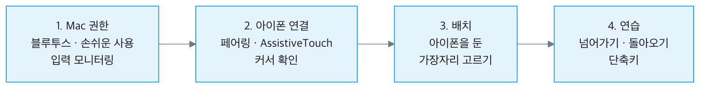
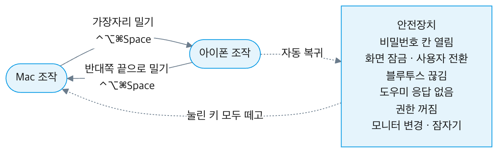
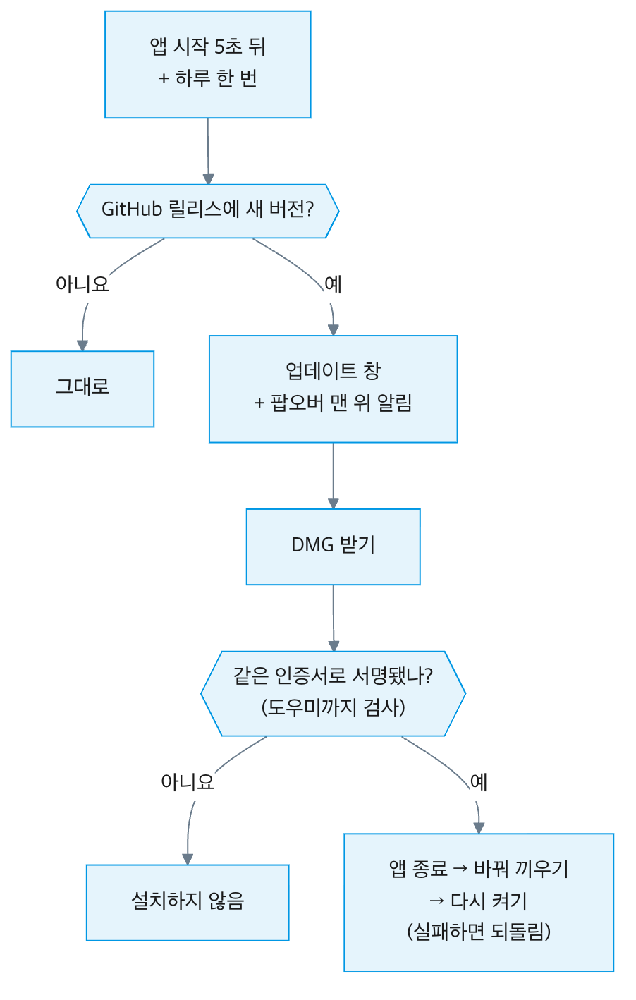
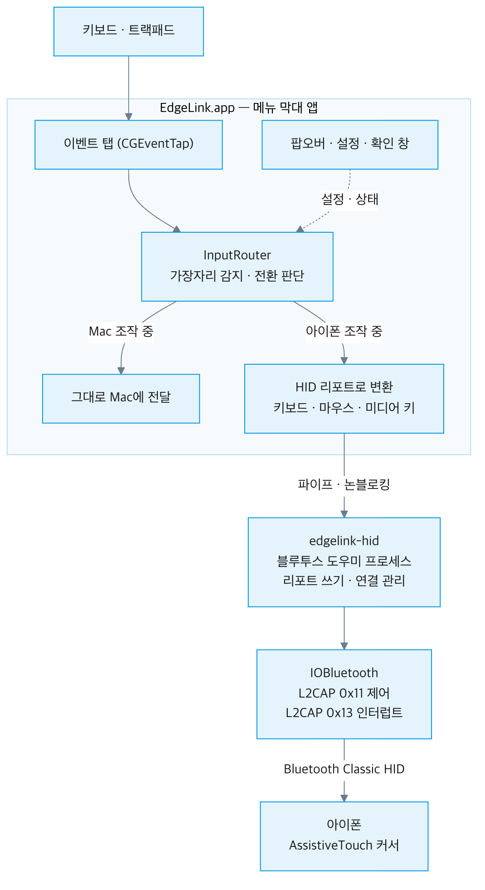
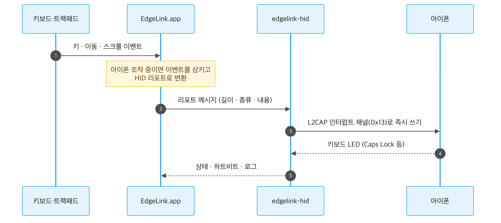
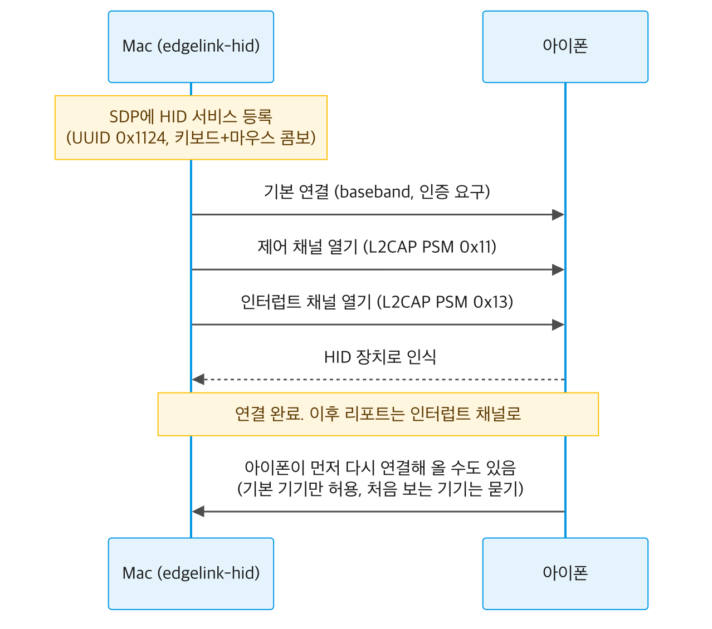

<p align="center">
  
</p>

<h1 align="center">EdgeLink</h1>

<p align="center">
  <b>Mac 키보드·트랙패드로 아이폰까지.</b><br>
  커서를 화면 끝으로 밀면 아이폰으로 넘어가요. 아이폰엔 아무것도 설치하지 않아요.
</p>

<p align="center">
  <a href="https://github.com/JUNG-WOOSEUNG/EdgeLink/releases/latest"></a>
  
  
  
  
  
</p>

<p align="center">
  
</p>

---

## EdgeLink는 이런 앱이에요

메신저 답장이나 인증번호 하나 때문에 키보드에서 손을 떼고 아이폰을 집는 일을 없애 줘요.

아이폰을 Mac 옆에 두고, 그쪽 화면 끝으로 커서를 밀어 보세요. 그 순간부터 Mac의 키보드와 트랙패드가 아이폰을 움직여요. 반대로 밀면 다시 Mac으로 돌아와요. 아이폰을 모니터 하나 더 둔 것처럼 쓰는 거예요.

- **아이폰엔 설치할 게 없어요.** Mac이 아이폰에 블루투스 키보드·마우스로 연결돼요. 아이폰 입장에선 평범한 무선 키보드·마우스라서 앱이나 프로필이 필요 없어요.
- **화면은 아이폰에서 그대로 봐요.** 화면을 Mac으로 가져오는 미러링이 아니라, 조작만 Mac에서 해요.
- **입력은 밖으로 나가지 않아요.** 키 입력은 블루투스로 아이폰에만 가고, 어디에도 저장하지 않아요.

## 설치하기

1. [Releases](https://github.com/JUNG-WOOSEUNG/EdgeLink/releases/latest)에서 `EdgeLink.dmg`를 받아요.
2. DMG를 열고 EdgeLink를 Applications 폴더로 끌어 놓아요.
3. Applications에서 EdgeLink를 열면 처음 설정이 시작돼요. 아래 네 단계를 따라가면 3분 정도면 끝나요.

<p align="center">
  
</p>

| 단계 | 하는 일 |
| --- | --- |
| 1. Mac 권한 | 블루투스, 손쉬운 사용, 입력 모니터링을 허용해요. 키 입력을 아이폰으로 보내는 데 필요해요. |
| 2. 아이폰 연결 | 아이폰 설정 › Bluetooth에서 Mac과 페어링하고, AssistiveTouch를 켜요. AssistiveTouch는 아이폰 화면에 마우스 커서를 보여 주는 손쉬운 사용 기능이에요. |
| 3. 배치 | 아이폰을 Mac의 어느 쪽(왼쪽·오른쪽·위·아래)에 뒀는지 골라요. |
| 4. 연습 | 실제로 넘어갔다 돌아오며 익혀요. |

아직 Apple 공증을 받지 않은 베타라서 처음 열 때 macOS가 막을 수 있어요. 그러면 시스템 설정 › 개인정보 보호 및 보안 아래쪽의 "그래도 열기"를 한 번 눌러 주세요.

**요구 사항**: macOS 13 Ventura 이상의 Mac, iOS 13 이상의 아이폰(아이패드는 iPadOS 13.4 이상).

## 쓰는 법

### 넘어가기와 돌아오기

아이폰을 둔 쪽의 화면 가장자리(화면 끝 테두리)를 커서로 밀면 아이폰으로 넘어가요. 돌아올 때는 아이폰 화면의 반대쪽 끝으로 밀거나 단축키를 눌러요.

<p align="center">
  
</p>

- 가장자리를 밀기 시작하면 파란 유리 알약이 살짝 튀어나와 넘어갈 곳을 보여 줘요. 얼마나 세게 밀어야 넘어갈지는 설정에서 조절해요.
- 모니터가 여러 대여도 돼요. 다른 모니터와 맞닿지 않은 바깥쪽 가장자리를 쓸 수 있어요.
- 핫 코너와 겹치지 않게 화면 구석은 비워 두고, 파일이나 창을 끌고 있을 때는 넘어가지 않아요.
- Mac으로 돌아오면 커서는 아이폰 커서가 있던 높이에 나타나요. 위치가 어긋나면 설정 › 배치 › "돌아오는 위치 맞추기"로 한 번 맞추면 돼요.
- 그림 오른쪽 상자의 상황에서는 **누르지 않아도 바로 Mac으로 돌아와요.** 아래 "안심하고 쓰기"에서 자세히 설명해요.

### 입력

| Mac에서 | 아이폰에서 |
| --- | --- |
| 키보드 | 그대로 입력돼요. 한/영 전환은 Caps Lock |
| 클릭 · 드래그 · 오른쪽 클릭 | 그대로 |
| 두 손가락 스크롤 | 위아래·좌우 스크롤. 홈 화면은 한 번에 한 장씩 넘어가요 |
| 트랙패드 제스처 | 앱 전환기·홈 등 (아래 표) |
| 볼륨·재생 키 | 아이폰 볼륨·재생 (설정에서 켰을 때) |
| `⌃⌥⌘V` 클립보드 보내기 | Mac에서 복사한 글을 아이폰에 대신 타이핑 (영문·숫자·기호) |

### 트랙패드 제스처

제스처를 쓰려면 아이폰 AssistiveTouch에 버튼을 한 번 등록해야 해요. 설정 › 입력 › "트랙패드 제스처 설정"을 누르면 앱이 단계별로 안내해 줘요(1~2분). 등록만 해 두면 오른쪽 단축키로도 같은 동작을 열 수 있어요.

| 제스처 | 아이폰에서 열리는 것 | 단축키 |
| --- | --- | --- |
| 세 손가락 위로 쓸기 | 앱 전환기 | `⌃⌥⌘↑` |
| 네 손가락 모으기 | 홈 화면 | `⌃⌥⌘H` |
| 세 손가락 아래로 쓸기 | 알림 센터 | `⌃⌥⌘↓` |
| 네 손가락 아래로 쓸기 | 제어 센터 | `⌃⌥⌘C` |
| — | 잠금 화면 | `⌃⌥⌘L` |

### 단축키

| 동작 | 기본 단축키 |
| --- | --- |
| Mac ↔ 아이폰 전환 | `⌃⌥⌘Space` |
| 클립보드를 아이폰에 입력 | `⌃⌥⌘V` |
| 가장자리 전환 켜기/끄기 | `⌃⌥⌘E` |

모든 단축키는 설정 › 입력에서 바꿀 수 있어요. macOS 기본 단축키와 겹치면 저장하기 전에 알려 줘요.

## 화면 미리보기

<table>
  <tr>
    <td width="50%"></td>
    <td width="50%"></td>
  </tr>
  <tr>
    <td align="center"><sub>메뉴 막대 팝오버: 연결 상태와 지금 조작 중인 기기</sub></td>
    <td align="center"><sub>처음 설정: 아이폰을 둔 쪽 고르기</sub></td>
  </tr>
  <tr>
    <td></td>
    <td></td>
  </tr>
  <tr>
    <td align="center"><sub>설정 › 입력: 단축키와 입력 옵션</sub></td>
    <td align="center"><sub>트랙패드 제스처 설정 도우미</sub></td>
  </tr>
</table>

다크 모드와 연결 실패·권한 꺼짐 같은 상황별 화면은 [docs/screens](docs/screens/README.md)에서 모두 볼 수 있어요.

## 안심하고 쓰기

키 입력을 다루는 앱이라, 입력이 엉뚱한 곳으로 가지 않게 하는 것을 가장 먼저 챙겨요.

### 안전장치: 이럴 땐 바로 Mac으로 돌아와요

| 상황 | 이유 |
| --- | --- |
| Mac에 비밀번호 칸이 열렸을 때 | 비밀번호가 아이폰으로 가지 않게 |
| 화면을 잠그거나(`⌃⌘Q`) 화면 보호기·사용자 전환이 될 때 | 자리를 비운 사이 입력이 이어지지 않게 |
| 블루투스가 끊기거나 응답이 멈췄을 때 | 입력이 아무 데도 안 가는 상태를 막으려고 |
| 손쉬운 사용·입력 모니터링 권한이 꺼졌을 때 | 권한 없이는 Mac 입력을 막을 수 없어서 |
| 모니터를 연결·분리하거나 Mac이 잠들 때 | 화면 배치가 바뀌어서 |

돌아올 때는 눌려 있던 키를 모두 떼고 돌아와서, Mac에 키가 눌린 채 남지 않아요.

### 개인정보

| 항목 | EdgeLink가 하는 일 |
| --- | --- |
| 키 입력 · 클립보드 내용 | 저장하지 않아요. 아이폰을 조작하는 동안에만 블루투스로 아이폰에 전달해요. |
| 연결 기록 | 연결 단계와 오류만 남기고, 기기 주소는 뒷자리를 가려요 (`A4:83:5C:**:**:**`). |
| 연결 허용 | 처음 고른 아이폰만 자동으로 연결해요. 처음 보는 기기가 연결해 오면 먼저 물어봐요. |
| 인터넷 | 새 버전을 확인할 때만 써요. 설정 › 정보에서 끌 수 있어요. |

### 자동 업데이트

앱을 켤 때와 켜 둔 동안 하루에 한 번, 이 저장소에 새 버전이 올라왔는지 확인해요. 새 버전이 있으면 업데이트 창과 팝오버 맨 위 알림으로 알려 주고, "업데이트"를 누르면 아래 순서로 설치해요.

<p align="center">
  
</p>

받은 앱이 지금 앱과 **같은 인증서로 서명된 경우에만** 설치해서, 누군가 바꿔치기한 파일은 설치되지 않아요. 바꿔 끼우다 실패하면 예전 앱으로 되돌려요.

## 자주 묻는 질문

<details>
<summary>유니버설 컨트롤과 뭐가 다른가요?</summary>

유니버설 컨트롤은 Mac과 아이패드 사이에서만 동작해요. EdgeLink는 Mac을 블루투스 키보드·마우스로 만들기 때문에 아이폰도 조작할 수 있어요.
</details>

<details>
<summary>클립보드 보내기로 한글도 보낼 수 있나요?</summary>

아직은 안 돼요. 키보드로 한 글자씩 타이핑하는 방식이라 영문·숫자·기호만 보낼 수 있어요. 한글이 섞여 있으면 보내기 전에 어떤 글자가 빠지는지 보여 줘요. 키보드로 직접 칠 때는 한글이 잘 입력돼요.
</details>

<details>
<summary>세 손가락 위로 쓸면 Mac의 Mission Control이 열려요.</summary>

Mac이 같은 제스처를 먼저 가져가서 그래요. 시스템 설정 › 트랙패드 › 추가 제스처에서 그 제스처를 끄거나, `⌃⌥⌘↑` 단축키를 쓰면 돼요.
</details>

<details>
<summary>회사 Mac에서도 쓸 수 있나요?</summary>

회사 정책(MDM, 매체 제어)으로 권한이나 블루투스 키보드가 막혀 있으면 쓸 수 없어요. 앱이 이런 경우를 알아채면 관리자에게 보낼 안내를 만들어 줘요.
</details>

## 알려진 문제

- 아이폰 블루투스를 껐다 켜면 다시 연결되기까지 오래 걸리거나 붙지 않을 수 있어요. 그동안 메뉴 막대가 멈추던 문제는 고쳤고, 다시 연결되는 문제는 계속 살펴보고 있어요.
- 아이폰 앱 사이 좌우 넘기기와 뒤로 가기 제스처는 아직 지원하지 않아요.

---

## 어떻게 동작하나요

> 여기부터는 개발자를 위한 내용이에요.

### 전체 구조

입력은 그림의 위에서 아래로 흘러요. EdgeLink 앱이 Mac 입력을 가로채서, 아이폰을 조작하는 중일 때만 블루투스 키보드·마우스 신호(HID 리포트)로 바꿔 아이폰에 보내요.

<p align="center">
  
</p>

| 구성 요소 | 하는 일 |
| --- | --- |
| 이벤트 탭 (CGEventTap) | Mac의 키·마우스·스크롤 입력을 받아요. 아이폰 조작 중엔 Mac에 가지 않게 삼켜요. |
| InputRouter · SwitchEngine | 가장자리를 충분히 밀었는지 판단하고, 돌아올 때 Mac 커서를 둘 높이를 계산해요. |
| HID 리포트 변환 | Mac 키 코드를 USB HID 사용 코드로, 트랙패드 이동·스크롤을 마우스 리포트로 바꿔요. |
| edgelink-hid | 블루투스 연결과 리포트 쓰기만 하는 별도 프로세스예요. macOS 블루투스 라이브러리가 몇 초씩 멈춰도 앱 화면과 Mac 복귀는 멈추지 않게 떼어 놨어요. |

### 입력 한 번이 전달되는 순서

키를 한 번 누르면 그림의 번호 순서로 전달돼요. 앱과 도우미는 파이프로 짧은 메시지를 주고받고, 도우미는 받은 리포트를 모으지 않고 바로 아이폰에 써요.

<p align="center">
  
</p>

- 실제 기기에서 잰 Mac 쪽 쓰기 시간은 평균 0.03ms, 최대 0.09ms예요.
- 앱은 1초마다 오는 하트비트로 도우미를 지켜봐요. 끊기면 먼저 Mac 조작으로 돌아온 뒤 도우미만 다시 띄워 연결해요.

### 블루투스 연결 순서

Mac이 아이폰에 "키보드+마우스" 장치로 자신을 알리고, 채널 두 개를 열면 연결이 끝나요.

<p align="center">
  
</p>

연결이 끊기면 15·15·30·60·300초 간격으로 다시 시도하고, 아이폰이 먼저 다시 연결해 오면 받아요(처음 고른 기기만).

### HID 리포트

| Report ID | 장치 | 내용 |
| --- | --- | --- |
| 1 | 키보드 | 수정키 1바이트 + 예약 1바이트 + 키 6개, LED 출력 1바이트 |
| 2 | 마우스 | 버튼 8개 + X · Y · 휠 · 가로 스크롤 (각 −127~127) |
| 3 | Consumer Control | 16비트 사용 코드 1개 (볼륨 · 재생 등) |

트랙패드 제스처는 마우스 버튼 4~8로 보내고, 아이폰 AssistiveTouch에서 각 버튼에 동작을 지정해 써요.

## 직접 빌드하기

Xcode 없이 Command Line Tools(Swift 5.10 이상)만 있어도 돼요.

```sh
./scripts/build-app.sh          # 디버그 앱 → build/EdgeLink.app (도우미 포함, 같은 인증서로 서명)
./scripts/test.sh               # 단위 테스트
./scripts/make-dmg.sh --build   # 릴리스 빌드와 끌어서 설치하는 DMG → build/EdgeLink.dmg
./scripts/release.sh 0.4.0 -F notes.md   # 버전 올림 → 테스트 → DMG → 태그 → GitHub 릴리스
./scripts/render-diagrams.sh    # docs/diagrams 도식 원본 → README 이미지
```

```
Sources/
├── EdgeLink/          메뉴 막대 앱 (SwiftUI): 화면, InputRouter, 업데이트
├── EdgeLinkCore/      앱·도우미가 같이 쓰는 핵심: 블루투스 HID, 리포트, 전환 판정, 배치 계산
├── edgelink-hid/      블루투스 도우미 실행 파일
└── bthid/             연결 시험용 명령줄 도구
Tests/EdgeLinkCoreTests/   단위 테스트 (Swift Testing)
docs/                  설계, 진행 기록, 화면 캡처, 도식 원본
```

개발용 옵션: `EDGELINK_SNAPSHOT=<폴더>`(모든 화면을 PNG로 저장), `EDGELINK_SHOW_DIALOG=<이름>`(확인 창을 실제 창으로 띄우기), `EDGELINK_UPDATE_FEED=<주소>`(업데이트 확인 주소 바꾸기).

설계는 [docs/DESIGN.md](docs/DESIGN.md), 진행 기록은 [docs/DEVLOG.md](docs/DEVLOG.md)에 있어요. 버그 제보와 아이디어는 [Issues](https://github.com/JUNG-WOOSEUNG/EdgeLink/issues)에 남겨 주세요.

## 라이선스

MIT 라이선스 · 자세한 내용은 [LICENSE](LICENSE)를 보세요.

<sub>iPhone, iPad, Mac, macOS, AssistiveTouch는 Apple Inc.의 상표예요. EdgeLink는 Apple과 관련이 없는 독립 프로젝트예요.</sub>
